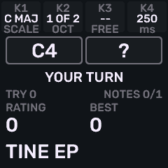
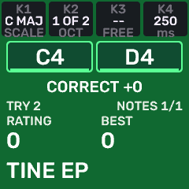

# FM-1 Ear Trainer

**On your FM-1: stop playback, hold HOME and press PLAY to open Ear Trainer.**

Turn SELECT (or K1) to choose **Pitch training**, **Metronome**, **Keep tempo**, or **Missing beats**, then press PLAY. HOME returns to this shared training menu; HOME again leaves training. In the browser, choose **Start training** to open the same menu. All four activities are included in one firmware.

Listen to the notes, then play the hidden ones on the keyboard—in any order, separately or together. Highlighted notes are safe to play again while you work out the rest.

**[Try this branch in your browser](https://copych.github.io/feature-metronome-training-games/emu/)** · **[Install this branch on your FM-1](https://copych.github.io/feature-metronome-training-games/webapp/installer/)** · [Branch guide](https://copych.github.io/feature-metronome-training-games/webapp/manual/) · [Main version](https://copych.github.io/FM1-Ear-Trainer/)

  

## Pitch training controls

| Control | What it does |
| --- | --- |
| HOME + PLAY | Open the shared training menu |
| K1 | C major / A minor |
| K2 | How many notes to guess out of 1–4, in one octave or across the keyboard |
| K4 | Time between notes; 0 plays them together |
| PRESETS | Choose a polyphonic FM6 or Prophet sound |
| PLAY | Hear the question again |
| REC | Skip to the next question |
| HOME | Return to the training menu; HOME again exits |

Green means correct and moves to the next question. Red means a mistake and repeats the question. RATING starts at zero and rewards first-try answers; BEST remembers your highest rating for each mode.

Settings and ratings are saved. Leave training and let saving finish before switching off. In the browser, choose **Start training**.

## Metronome and rhythm games

Choose **Metronome**, **Keep tempo**, or **Missing beats** from the shared training menu. **HOME + REC** remains a direct rhythm shortcut when outside training.

Set 30–300 BPM, choose among 19 meters/groupings (including 5, 7, 11, 13 and 15), and use straight subdivisions, offbeats, swing or tresillo. PRESETS offers 16 complete setups and four saved user slots.

| Control | What it does |
| --- | --- |
| K1–K4 | BPM, meter/grouping, rhythm, practice / keep tempo / missing beats |
| SELECT | Turn between the two settings pages |
| K1–K4, second page | Subdivision 1–4, click volume, silent bars 1–4, timing tolerance ±10–150 ms |
| PLAY | Start/stop; start another round after results |
| REC | Tap quarter-note tempo; averages up to four intervals |
| Any keyboard key / MIDI note | Submit a game tap |
| PRESETS | Load a factory setup or a saved user slot |
| OCT+ | Save current settings into the selected user slot |
| OCT- | Restart with a new count-in |
| ALGORITHM | Input timing correction −100 to +100 ms |
| HOME | Return to the training menu and save settings/presets |

**Keep tempo:** one audible count-in bar, then eight bars alternating one guide bar with your chosen number of silent bars. Tap every silent beat. **Missing beats:** tap the second, fourth, sixth… meter beats while the other beats play. In 1/4, tap every scored beat. Games use the meter’s denominator beats; rhythm patterns/subdivisions apply to free practice. BPM always counts quarter notes.

Results show a timing-weighted score, hits, misses, extra taps, mean absolute error, signed early/late bias and timing consistency (SD). Game visuals hide the pulse after count-in. The browser aligns captured taps with the audio output clock automatically when supported; ALGORITHM adds a manual input correction (start at 0 ms). Use wired audio for consistent timing. See the [metronome guide](https://copych.github.io/feature-metronome-training-games/webapp/manual/#metronome) for details. Device settings save after leaving the screen; browser settings and user slots are remembered locally. Round results are session-only.

Built on [Melodee](https://github.com/keremimo/melodee), with FM6 and Prophet sounds. [GPL-3.0](LICENSE) · [Component licences](melodee/LICENSING.md) · [Development docs](docs/DEVELOPMENT.md). Independent project; not affiliated with M-VAVE.
