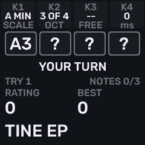

# FM-1 Ear Trainer

**To start the game on your FM-1: stop playback, hold HOME and press PLAY.**

Listen to the notes, then play the hidden ones on the keyboard—in any order, separately or together. Highlighted notes are safe to play again while you work out the rest.

**[Try it in your browser](https://copych.github.io/FM1-Ear-Trainer/feature-metronome-training-games/emu/)** · **[Install on your FM-1](https://copych.github.io/FM1-Ear-Trainer/feature-metronome-training-games/webapp/installer/)** · [Full guide](https://copych.github.io/FM1-Ear-Trainer/webapp/manual/)

  

## Controls

| Control | What it does |
| --- | --- |
| HOME + PLAY | Start training (hold HOME, then press PLAY) |
| K1 | C major / A minor |
| K2 | How many notes to guess out of 1–4, in one octave or across the keyboard |
| K4 | Time between notes; 0 plays them together |
| PRESETS | Choose a polyphonic FM6 or Prophet sound |
| PLAY | Hear the question again |
| REC | Skip to the next question |
| HOME | Leave training |

Green means correct and moves to the next question. Red means a mistake and repeats the question. RATING starts at zero and rewards first-try answers; BEST remembers your highest rating for each mode.

Settings and ratings are saved. Leave training and let saving finish before switching off. In the browser, choose **Start training**.

Built on [Melodee](https://github.com/keremimo/melodee), with FM6 and Prophet sounds. [GPL-3.0](LICENSE) · [Component licences](melodee/LICENSING.md) · [Development docs](docs/DEVELOPMENT.md). Independent project; not affiliated with M-VAVE.
